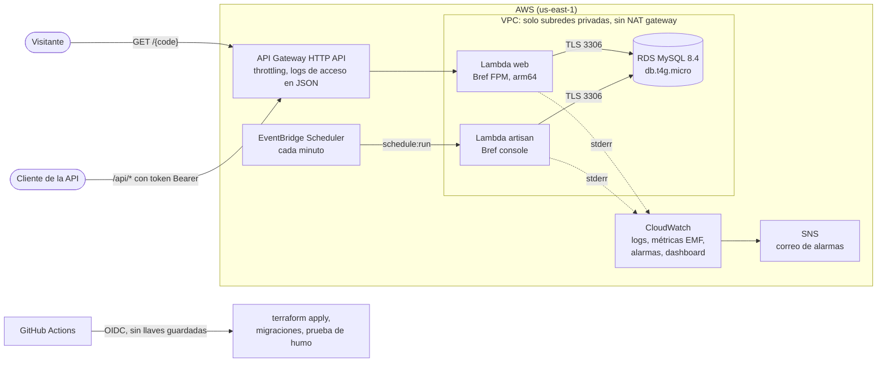
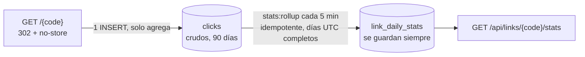

# laravel-serverless-aws

[English](README.md) · **Español**

[](https://github.com/JulianContreras02/laravel-serverless-aws/actions/workflows/ci.yml)


[](LICENSE)


<sub>Una ejecución real en local, grabada con [VHS](https://github.com/charmbracelet/vhs) a partir de [`docs/demo/demo.tape`](docs/demo/demo.tape). `docs/demo/record.sh` la vuelve a generar.</sub>

Una API para acortar enlaces con estadísticas de clics, hecha como referencia para llevar una **aplicación PHP
legada a serverless en AWS**. Es pequeña, pero tiene todo lo que necesita un servicio en producción: Laravel 13 en
AWS Lambda con [Bref](https://bref.sh), RDS MySQL, infraestructura en Terraform, CI/CD en GitHub Actions con OIDC
(sin llaves de AWS guardadas), logs estructurados, métricas propias, alarmas y una estimación de costos. Una versión
de la misma app en PHP plano y una [guía de migración](docs/migration-guide.md) muestran el antes y el después.

## Qué problema resuelve

Muchas empresas tienen aplicaciones PHP en un único servidor encendido todo el día. Lo pagan las 24 horas aunque el
tráfico sea bajo, los crons fallan en silencio cuando la máquina tiene problemas, desplegar es copiar archivos y nadie
quiere tocar el código. Este repositorio muestra a dónde llega una migración, con una app lo bastante pequeña para
leerla de una sentada:

- **Se paga por petición** y no hay servidor que parchar. La base de datos es lo único que está siempre encendido, y
  es casi toda la factura ([costo estimado](#costo-estimado)).
- **El mismo código Laravel** corre en local con Docker y en Lambda, sobre la misma imagen del runtime de PHP.
- **Los crons pasan a ser tareas programadas, versionadas y monitoreadas.** Si la consolidación programada deja de
  correr, una alarma avisa.
- **Los despliegues se revisan y se pueden repetir**: plan, aprobación, apply, migraciones y una prueba de humo, con
  credenciales de corta duración.

## Arquitectura



Cómo un clic se convierte en estadística:



- **Dos funciones, un solo zip.** `web` corre PHP-FPM detrás de API Gateway. `artisan` corre el scheduler de Laravel
  cada minuto y comandos puntuales como las migraciones. Las dos usan la capa `php-84` de Bref, y `BREF_RUNTIME`
  elige el modo.
- **Red privada sin NAT gateway.** Las funciones solo llegan a RDS. Los logs y las métricas salen por el propio
  servicio de Lambda, así que no hace falta la pieza más cara de una VPC típica (unos USD 32 al mes).
- **Escribir es barato y la lectura ya viene calculada.** Una redirección agrega una fila. Una consolidación
  programada convierte los clics crudos en agregados diarios, así que el endpoint de estadísticas cuesta lo mismo con
  100 clics que con 1.000.000.

## API

| Método | Ruta | Auth | Descripción |
|---|---|---|---|
| `GET` | `/{code}` | pública | `302` al destino y registra el clic. `404` si no existe, `410` si venció o está desactivado. |
| `GET` | `/health` | pública | Conexión a la base de datos (`200` / `503`); la usa la prueba de humo del despliegue. |
| `POST` | `/api/links` | bearer | Crea un enlace: `url`, y opcionalmente `alias` (3 a 32 caracteres) y `expires_at`. |
| `GET` | `/api/links/{code}` | bearer | Datos del enlace. |
| `DELETE` | `/api/links/{code}` | bearer | Desactiva el enlace (borrado lógico; sus estadísticas se conservan). |
| `GET` | `/api/links/{code}/stats?days=30` | bearer | Clics por día (serie completa), principales sitios de origen y dispositivos, de 1 a 90 días. |

Por cada clic solo se guardan el **host** del sitio de origen y una **clase de dispositivo** aproximada: ni
direcciones IP, ni rutas, ni parámetros de la URL. Los clics crudos se borran a los 90 días; los agregados diarios se
conservan.

## Ejecutarlo en local

Solo hace falta Docker. PHP y Composer corren dentro de los contenedores.

```bash
git clone https://github.com/JulianContreras02/laravel-serverless-aws.git
cd laravel-serverless-aws
cp .env.example .env
docker compose up -d
docker compose exec app composer install
docker compose exec app php artisan key:generate
docker compose exec app php artisan migrate
```

La API queda en <http://localhost:8000>. El contenedor `app` usa la imagen de desarrollo de Bref: el mismo build de
PHP que la capa de Lambda, detrás de un emulador local de API Gateway, así que las peticiones pasan por el mismo
runtime FPM que en AWS.

```bash
# Crear un enlace (el token local está en .env)
curl -X POST http://localhost:8000/api/links \
  -H "Authorization: Bearer local-dev-token" -H "Content-Type: application/json" -H "Accept: application/json" \
  -d '{"url": "https://example.org/docs", "alias": "hello"}'

# Seguirlo unas cuantas veces
curl -i http://localhost:8000/hello -H "Referer: https://news.example.net/post"

# Consolidar ya, sin esperar a la tarea programada, y leer las estadísticas
docker compose exec app php artisan stats:rollup
curl "http://localhost:8000/api/links/hello/stats?days=7" -H "Authorization: Bearer local-dev-token"
```

En PowerShell de Windows, usa `Copy-Item .env.example .env` y `curl.exe`.

## Tests y controles de calidad

```bash
docker compose exec app composer test      # Pest: 84 tests contra MySQL 8.4 (no SQLite)
docker compose exec app composer lint      # Laravel Pint
docker compose exec app composer analyse   # Larastan en el nivel máximo
docker compose exec app composer check     # los tres
```

El CI ([`ci.yml`](.github/workflows/ci.yml)) corre en cada push y pull request:

- Pint y Larastan.
- Pest contra un servicio MySQL 8.4, con un mínimo de cobertura del 90 % (hoy está en 98 %).
- Un build del zip para Lambda.
- `terraform fmt -check` y `terraform validate` en los dos stacks.

Una [prueba de volumen de peor caso](docs/benchmarks.md) llena la base de datos con hasta 1M de clics sobre un
enlace viral:

| Clics en la ventana | Trabajo de BD de la redirección p50 / p95 | Estadísticas desde agregados p50 / p95 | Estadísticas desde clics crudos p50 / p95 |
|---:|---:|---:|---:|
| 100.000 | 4,5 / 7,1 ms | 2,4 / 3,5 ms | 71 / 90 ms |
| 1.000.000 | 4,6 / 12,9 ms | 2,6 / 4,5 ms | 740 / 971 ms |

## Observabilidad

- **Logs estructurados.** Cada petición deja una línea de log en JSON con el patrón de la ruta, el estado y la
  duración. El request id es el de API Gateway, así que los logs de la app se cruzan con los logs de acceso en JSON
  del gateway; además se devuelve en `X-Request-Id`. El formateador de Bref antepone a cada línea el request id de
  Lambda.
- **Métricas propias sin SDK.** `RedirectServed`, `ClickDropped`, `LinkCreated` y `RollupDuration` se escriben en
  stderr con el [Embedded Metric Format de CloudWatch](https://docs.aws.amazon.com/AmazonCloudWatch/latest/monitoring/CloudWatch_Embedded_Metric_Format.html),
  así que ninguna llamada de red sale de la VPC. El código del enlace va como propiedad del log y no como dimensión,
  para no crear una métrica facturable por cada enlace.
- **Ocho alarmas** hacia SNS:
  - Errores 5xx y latencia p95 de la API.
  - Throttling de la función.
  - Errores de Artisan: si un comando programado falla, la invocación falla.
  - Clics que no se pudieron guardar.
  - CPU y almacenamiento de la base de datos.
  - Un **dead man's switch** que salta cuando la consolidación deja de reportar durante 15 minutos, sea cual sea la
    causa.
- **Un dashboard** con las métricas del gateway, Lambda, RDS y del negocio lado a lado.
- **Métricas DORA.** Cada despliegue queda como un deployment de GitHub del environment `production`, que registra la
  frecuencia de despliegue y el lead time. Ver [deployment.md](docs/deployment.md#dora-metrics).

## Costo estimado

Costo mensual en us-east-1 con precios de lista bajo demanda, para la configuración por defecto. Revisa la
[calculadora de precios de AWS](https://calculator.aws/) antes de confiar en estas cifras.

| Servicio | Supuesto | ~100k redirecciones/mes | ~1M redirecciones/mes |
|---|---|---:|---:|
| RDS MySQL `db.t4g.micro`, una sola AZ | 730 h × USD 0,016 | 11,68 | 11,68 |
| Almacenamiento gp3 de RDS | 20 GB × USD 0,115 (los backups hasta el tamaño de la BD son gratis) | 2,30 | 2,30 |
| Lambda `web` (arm64, 1 GB) | ~60 ms por petición | 0,10 | 1,00 |
| Lambda `artisan` (arm64, 512 MB) | `schedule:run` 43.200 veces al mes | 0,10 | 0,10 |
| API Gateway HTTP API | USD 1,00 por millón de peticiones | 0,10 | 1,00 |
| CloudWatch Logs | USD 0,50/GB ingerido, retención de 14 días | 0,05 | 0,50 |
| Métricas, alarmas, dashboard, Scheduler, SNS, estado en S3 | dentro de las cuotas gratuitas permanentes | 0,00 | 0,00 |
| NAT gateway, IPv4 pública, balanceador | no se usan | 0,00 | 0,00 |
| **Total** | | **≈ USD 14** | **≈ USD 17** |

- **Con la capa gratuita de AWS**:
  - Lambda (1M de peticiones y 400.000 GB-segundo), 5 GB de CloudWatch Logs, 10 métricas propias, 10 alarmas,
    3 dashboards y 14M de invocaciones de Scheduler son gratis todos los meses. Eso cubre todo menos RDS y
    API Gateway.
  - Las cuentas creadas antes del 15 de julio de 2025 tienen además 12 meses de `db.t4g.micro` (750 h), 20 GB de
    almacenamiento y 1M de llamadas a HTTP API al mes, con lo que el total baja a unos **USD 0–1**.
  - Las cuentas más nuevas reciben créditos del plan gratuito en su lugar.
- **La base de datos es más del 80 % de la factura.** Lambda y API Gateway solo pasan a ser el costo principal con
  varios millones de peticiones al mes.
- **Lo que subiría el costo:**

  | Cambio | Costo aproximado |
  |---|---|
  | NAT gateway | +32 USD al mes |
  | VPC endpoints de interfaz | ~7 USD al mes cada uno, por AZ |
  | RDS Proxy | ~22 USD al mes |
  | Multi-AZ | duplica RDS |
  | Dominio propio | zona alojada en Route 53 a 0,50 USD al mes; el certificado de ACM es gratis |

## Despliegue

En corto (la guía completa está en [docs/deployment.md](docs/deployment.md)):

1. Un administrador aplica [`infra/bootstrap`](infra/bootstrap) una sola vez. Crea el bucket cifrado para el estado,
   el proveedor OIDC de GitHub y un rol de despliegue que solo pueden asumir los jobs de este repositorio en el
   environment `production`. El rol solo puede crear roles IAM que lleven un permissions boundary fijo, así que no
   puede escalar privilegios.
2. En GitHub, crea el environment `production` (con revisores obligatorios y solo para `main`) y define las
   variables `AWS_REGION`, `AWS_DEPLOY_ROLE_ARN` y `TF_STATE_BUCKET`. El secret `ALARM_EMAIL` es opcional.
   **Sin llaves de AWS.**
3. Ejecuta **Actions → Deploy** ([`deploy.yml`](.github/workflows/deploy.yml)). Por defecto solo construye y hace el
   plan. Si marcas **apply**, aplica, corre las migraciones con la función de Artisan y hace la prueba de humo sobre
   `/health`.

Este repositorio no está desplegado públicamente, para mantener la cuenta en costo cero. Todo menos el apply en AWS se
verifica en el CI, y el zip empaquetado se probó en el emulador de Lambda de Bref con los dos runtimes.

## Decisiones de diseño y sus trade-offs

| Decisión | Alternativas consideradas | Por qué esta, y lo que cuesta |
|---|---|---|
| **RDS MySQL, Lambda en una VPC, sin NAT gateway** | DynamoDB; NAT gateway; Aurora Serverless v2 | Una migración real de un sistema legado conserva sus datos y su SQL en MySQL. DynamoDB costaría menos, pero obliga a reescribir. Un NAT gateway costaría más que todo lo demás junto. Cuando Aurora escala a cero, tarda demasiado en volver para servir redirecciones. **Costo:** las funciones no pueden llamar a APIs de AWS ni a internet. |
| **INSERT del clic en la misma petición** | Cola SQS y un worker | Un solo insert que solo agrega: toda la redirección hace unos 4,5 ms de trabajo en la base de datos, estable hasta 1M de clics. Llegar a SQS desde la VPC necesita un NAT gateway o un endpoint. Si el insert falla, se reporta (`ClickDropped`), pero nunca bloquea la redirección. **Revisar** cuando el tráfico sostenido convierta el insert en un cuello de botella. |
| **Clics que solo se agregan + consolidación periódica** | `hits = hits + 1`; agregar los clics crudos al leer | Evita una fila caliente en los enlaces virales y mantiene las lecturas en O(días) ([prueba de volumen](docs/benchmarks.md)). **Costo:** las estadísticas llegan con hasta 5 minutos de retraso. |
| **La consolidación reconstruye una ventana de 2 días** | Marca de agua incremental | Idempotente y simple: correrla dos veces no hace daño, así que no necesita bloqueo. Lee con un SELECT normal, porque un `INSERT … SELECT` bloquearía los clics que se están insertando. **Revisar** cuando la ventana tenga decenas de millones de filas. |
| **302 con `no-store`** | 301 | Los navegadores guardan en caché un 301, lo que oculta los clics siguientes y hace inútil desactivar un enlace. **Costo:** cada visita llega a la API. |
| **Zip + capa de Bref** | Imagen de contenedor en ECR | Arranques en frío más rápidos y sin registro de imágenes. El paquete pesa 9 MB comprimido. **Cambiar** si se acerca a 250 MB o necesita binarios del sistema. |
| **HTTP API** | REST API; function URL de Lambda | Más barata que REST, con throttling, logs de acceso y dominios propios. Una function URL es gratis, pero no tiene throttling. **Costo:** no hay WAF nativo (haría falta CloudFront). |
| **Secretos generados por Terraform, en variables de entorno de Lambda** | Secrets Manager en tiempo de ejecución | Cifrados en reposo y nunca en git. Leer Secrets Manager desde la VPC necesita un endpoint. **Costo:** los secretos viven en el estado de Terraform (cifrado y con acceso restringido). |
| **Un solo token Bearer que falla cerrado** | Usuarios con Sanctum; Cognito | Alcance de un solo cliente. Se compara en tiempo constante y se verifica antes del route binding, para que nadie pueda averiguar qué códigos existen. |
| **Caché de rutas en el build, caché de config en el arranque en frío** | `config:cache` en el CI | Cachear la config en el build congelaría el entorno del CI; Bref la cachea con las variables de la Lambda. La caché de rutas se reconstruye en cada despliegue, así que nunca queda vieja. |
| **arm64** | x86_64 | Cerca de 20 % más barato por GB-segundo, y las capas de Bref lo soportan. |
| **Tests sobre MySQL** | SQLite en memoria | Las collations (códigos que distinguen mayúsculas), los upserts y las funciones de fecha se comportan como en producción. |

## Qué cambiaría para una carga de producción mayor

- **Acceso a la base de datos.**
  - Crear un usuario de la aplicación con privilegios mínimos en lugar de usar el usuario maestro.
  - Usar autenticación IAM de la base de datos o credenciales rotadas de Secrets Manager, detrás de un VPC endpoint.
  - Agregar RDS Proxy cuando crezca la concurrencia, y Multi-AZ para disponibilidad.
- **Ingesta de clics por SQS o Kinesis** detrás de un VPC endpoint, más una consolidación incremental con marca de
  agua, cuando el tráfico sostenido llegue a cientos de peticiones por segundo.
- **Un dominio propio**, con CloudFront y AWS WAF (reglas por tasa, control de bots) delante de la API.
- **API multiusuario** (Sanctum o Cognito) con enlaces por dueño, y una verificación de URLs maliciosas al crear el
  enlace (por ejemplo, Google Safe Browsing).
- **Un ambiente de staging.** El mismo código, otra llave de estado y promoción por tag.
- **Más controles en el CI.** Análisis de seguridad del código de Terraform (Trivy o Checkov) y acciones fijadas por
  SHA de commit.
- **Trazas** con X-Ray u OpenTelemetry (necesita un endpoint de X-Ray en la VPC) y copias de snapshots en otra región.

## Estructura del proyecto

```
app/                      Aplicación Laravel (controladores, servicios, métricas EMF, middleware)
database/migrations/      links, clicks, link_daily_stats
routes/                   api.php (gestión), public.php (redirección, health), console.php (tareas programadas)
tests/                    Pest: Feature (HTTP, consolidación, observabilidad) y Unit
php/conf.d/               Configuración de PHP que carga Bref, en local y en Lambda
scripts/                  package-lambda.sh (artefacto de despliegue), benchmark.php (solo local)
infra/bootstrap/          Bucket de estado, proveedor OIDC de GitHub, rol de despliegue, permissions boundary
infra/app/                VPC, RDS, Lambda, API Gateway, Scheduler, alarmas, dashboard
legacy/                   La versión en PHP plano que esto reemplaza (solo de referencia)
docs/                     Despliegue, guía de migración, prueba de volumen, GIF de la demo y su tape de VHS
.github/workflows/        ci.yml (cada push y PR), deploy.yml (manual, OIDC)
```

## De PHP legado a serverless

[`legacy/`](legacy) tiene una versión en PHP plano del mismo acortador, escrita a propósito como suele heredarse:
rutas en `.htaccess`, consultas `mysqli` armadas concatenando texto, sesiones y logs en disco, un contador
`hits = hits + 1` y un crontab. La [guía de migración](docs/migration-guide.md) relaciona cada uno de sus doce
problemas con lo que lo reemplazó. También describe el orden que sigo en la migración de un cliente (inventario,
tests de caracterización, eliminar el estado local, portar, IaC, datos y corte) y las trampas propias de Lambda.

## Licencia

[MIT](LICENSE)
