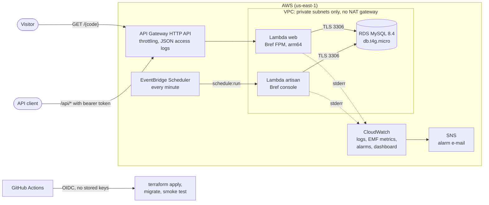
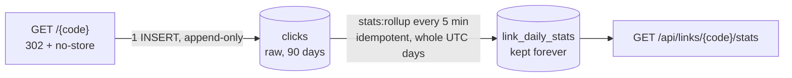

# laravel-serverless-aws

[](https://github.com/JulianContreras02/laravel-serverless-aws/actions/workflows/ci.yml)


[](LICENSE)

A URL shortener API with click analytics, built as a reference for moving a **legacy PHP application to
serverless on AWS**. It is small but has everything a production service needs: Laravel 13 on AWS Lambda with
[Bref](https://bref.sh), RDS MySQL, infrastructure in Terraform, CI/CD in GitHub Actions with OIDC (no stored AWS
keys), structured logs, custom metrics, alarms, and a cost estimate. A plain-PHP version of the same app and a
[migration guide](docs/migration-guide.md) show the before and after.

## The problem it solves

Many businesses run PHP applications on a single always-on server. They pay for it around the clock even when
traffic is low, cron jobs fail silently when the machine has problems, deploys mean copying files, and nobody wants
to touch the code. This repository shows the destination of a migration, using an app small enough to read in one
sitting:

- **Pay per request**, with no server to patch. The database is the only always-on piece, and the bill is dominated
  by it ([cost estimate](#cost-estimate)).
- **The same Laravel code** runs locally in Docker and in Lambda, using the same PHP runtime image.
- **Cron jobs become versioned, monitored schedules.** If the scheduled rollup stops running, an alarm says so.
- **Deploys are reviewed and repeatable**: plan, approval, apply, migrations and a smoke test, using short-lived
  credentials.

## Architecture



How a click becomes a statistic:



- **Two functions, one zip.** `web` runs PHP-FPM behind API Gateway. `artisan` runs Laravel's scheduler every minute
  and one-off commands such as migrations. Both use Bref's `php-84` layer, and `BREF_RUNTIME` selects the mode.
- **Private network without a NAT gateway.** The functions only reach RDS. Logs and metrics leave through the Lambda
  service itself, so the most expensive piece of a typical VPC (about USD 32/month) is not needed.
- **Writes are cheap, reads are precomputed.** A redirect appends one row. A scheduled rollup turns raw clicks into
  daily aggregates, so the stats endpoint costs the same at 100 or 1,000,000 clicks.

## API

| Method | Path | Auth | Description |
|---|---|---|---|
| `GET` | `/{code}` | public | `302` to the target and records the click. `404` if unknown, `410` if expired or disabled. |
| `GET` | `/health` | public | Database connectivity (`200` / `503`), used by the deploy smoke test. |
| `POST` | `/api/links` | bearer | Create a link: `url`, optional `alias` (3–32 chars) and `expires_at`. |
| `GET` | `/api/links/{code}` | bearer | Link details. |
| `DELETE` | `/api/links/{code}` | bearer | Disable the link (soft delete; its analytics are kept). |
| `GET` | `/api/links/{code}/stats?days=30` | bearer | Daily clicks (dense series), top referrers and devices, for 1–90 days. |

Only the referrer **host** and a coarse **device class** are stored per click: no IP addresses, paths or query
strings. Raw clicks are deleted after 90 days; daily aggregates are kept.

## Run it locally

Requirements: Docker. PHP and Composer run inside the containers.

```bash
git clone https://github.com/JulianContreras02/laravel-serverless-aws.git
cd laravel-serverless-aws
cp .env.example .env
docker compose up -d
docker compose exec app composer install
docker compose exec app php artisan key:generate
docker compose exec app php artisan migrate
```

The API is at <http://localhost:8000>. The `app` container is Bref's dev image: the same PHP build as the Lambda
layer behind a local API Gateway emulator, so requests go through the same FPM runtime as in AWS.

```bash
# Create a link (the local token is in .env)
curl -X POST http://localhost:8000/api/links \
  -H "Authorization: Bearer local-dev-token" -H "Content-Type: application/json" -H "Accept: application/json" \
  -d '{"url": "https://example.org/docs", "alias": "hello"}'

# Follow it a few times
curl -i http://localhost:8000/hello -H "Referer: https://news.example.net/post"

# Aggregate now instead of waiting for the schedule, then read the stats
docker compose exec app php artisan stats:rollup
curl "http://localhost:8000/api/links/hello/stats?days=7" -H "Authorization: Bearer local-dev-token"
```

On Windows PowerShell, use `Copy-Item .env.example .env` and `curl.exe`.

## Tests and quality checks

```bash
docker compose exec app composer test      # Pest: 84 tests against MySQL 8.4 (not SQLite)
docker compose exec app composer lint      # Laravel Pint
docker compose exec app composer analyse   # Larastan at the maximum level
docker compose exec app composer check     # all three
```

CI ([`ci.yml`](.github/workflows/ci.yml)) runs on every push and pull request:

- Pint and Larastan.
- Pest against a MySQL 8.4 service, with a 90% coverage floor (it is at 98%).
- A build of the Lambda zip.
- `terraform fmt -check` and `terraform validate` for both stacks.

A [worst-case volume benchmark](docs/benchmarks.md) fills the database up to 1M clicks on one viral link:

| Clicks in window | Redirect DB work p50 / p95 | Stats from aggregates p50 / p95 | Stats from raw clicks p50 / p95 |
|---:|---:|---:|---:|
| 100,000 | 4.5 / 7.1 ms | 2.4 / 3.5 ms | 71 / 90 ms |
| 1,000,000 | 4.6 / 12.9 ms | 2.6 / 4.5 ms | 740 / 971 ms |

## Observability

- **Structured logs.** Every request gets one JSON log line with the route pattern, status and duration. The request
  id is API Gateway's, so application logs join the gateway's JSON access logs, and it is returned as `X-Request-Id`.
  Bref's formatter prefixes every line with the Lambda request id.
- **Custom metrics without an SDK.** `RedirectServed`, `ClickDropped`, `LinkCreated` and `RollupDuration` are written
  to stderr in [CloudWatch Embedded Metric Format](https://docs.aws.amazon.com/AmazonCloudWatch/latest/monitoring/CloudWatch_Embedded_Metric_Format.html),
  so no network call leaves the VPC. The link code is a log property, not a dimension, to avoid one billable metric
  per link.
- **Eight alarms** to SNS:
  - API 5xx and p95 latency.
  - Function throttles.
  - Artisan errors: a failing scheduled command fails the invocation.
  - Dropped clicks.
  - Database CPU and storage.
  - A **dead man's switch** that fires when the rollup stops reporting for 15 minutes, whatever the cause.
- **A dashboard** with the gateway, Lambda, RDS and business metrics side by side.
- **DORA metrics.** Every deploy is a GitHub deployment of the `production` environment, which records deployment
  frequency and lead time. See [deployment.md](docs/deployment.md#dora-metrics).

## Cost estimate

Monthly cost in us-east-1 at on-demand list prices, for the default configuration. Check the
[AWS Pricing Calculator](https://calculator.aws/) before relying on these numbers.

| Service | Assumption | ~100k redirects/month | ~1M redirects/month |
|---|---|---:|---:|
| RDS MySQL `db.t4g.micro`, single-AZ | 730 h × USD 0.016 | 11.68 | 11.68 |
| RDS gp3 storage | 20 GB × USD 0.115 (backups up to the DB size are free) | 2.30 | 2.30 |
| Lambda `web` (arm64, 1 GB) | ~60 ms per request | 0.10 | 1.00 |
| Lambda `artisan` (arm64, 512 MB) | `schedule:run` 43,200 times a month | 0.10 | 0.10 |
| API Gateway HTTP API | USD 1.00 per million requests | 0.10 | 1.00 |
| CloudWatch Logs | USD 0.50/GB ingested, 14-day retention | 0.05 | 0.50 |
| Metrics, alarms, dashboard, Scheduler, SNS, S3 state | within the always-free quotas | 0.00 | 0.00 |
| NAT gateway, public IPv4, load balancer | not used | 0.00 | 0.00 |
| **Total** | | **≈ USD 14** | **≈ USD 17** |

- **With the AWS Free Tier**:
  - Lambda (1M requests and 400,000 GB-seconds), 5 GB of CloudWatch Logs, 10 custom metrics, 10 alarms,
    3 dashboards and 14M Scheduler invocations are free every month. That covers everything except RDS and
    API Gateway.
  - Accounts created before 15 July 2025 also get 12 months of `db.t4g.micro` (750 h), 20 GB of storage and 1M HTTP
    API calls per month, which brings the total to about **USD 0–1**.
  - Newer accounts get Free plan credits instead.
- **The database is over 80% of the bill.** Lambda and API Gateway only become the main cost at several million
  requests a month.
- **What would add cost:**

  | Change | Approximate cost |
  |---|---|
  | NAT gateway | +32 USD per month |
  | Interface VPC endpoints | ~7 USD per month each, per AZ |
  | RDS Proxy | ~22 USD per month |
  | Multi-AZ | doubles RDS |
  | Custom domain | Route 53 hosted zone at 0.50 USD per month; the ACM certificate is free |

## Deployment

Short version (full guide in [docs/deployment.md](docs/deployment.md)):

1. An administrator applies [`infra/bootstrap`](infra/bootstrap) once. It creates the encrypted state bucket, the
   GitHub OIDC provider and a deploy role that only this repository's jobs in the `production` environment can
   assume. The role can only create IAM roles that carry a fixed permissions boundary, so it cannot escalate.
2. In GitHub, create the `production` environment (required reviewers, `main` only) and set the variables
   `AWS_REGION`, `AWS_DEPLOY_ROLE_ARN` and `TF_STATE_BUCKET`. The `ALARM_EMAIL` secret is optional. **No AWS keys.**
3. Run **Actions → Deploy** ([`deploy.yml`](.github/workflows/deploy.yml)). By default it only builds and plans. With
   **apply** ticked, it applies, runs migrations through the Artisan function and smoke-tests `/health`.

This repository is not deployed publicly, to keep the account at zero cost. Everything except the AWS apply is
verified in CI, and the packaged zip was run in Bref's Lambda emulator through both runtimes.

## Design decisions and trade-offs

| Decision | Alternatives considered | Why this one, and the cost of it |
|---|---|---|
| **RDS MySQL, Lambda in a VPC, no NAT gateway** | DynamoDB; NAT gateway; Aurora Serverless v2 | A real legacy migration keeps its MySQL data and SQL. DynamoDB would cost less but means a rewrite. A NAT gateway would cost more than the rest of the stack. Aurora's scale-to-zero resumes too slowly for redirects. **Cost:** the functions cannot call AWS APIs or the internet. |
| **Synchronous click INSERT** | SQS queue and a worker | One append-only insert: the whole redirect does about 4.5 ms of database work, flat up to 1M clicks. Reaching SQS from the VPC needs a NAT gateway or an endpoint. A failed insert is reported (`ClickDropped`) but never blocks the redirect. **Revisit** when sustained traffic makes the insert a bottleneck. |
| **Append-only clicks + periodic rollup** | `hits = hits + 1`; aggregating raw clicks on read | Avoids a hot row on viral links and keeps reads O(days) ([benchmark](docs/benchmarks.md)). **Cost:** stats lag up to 5 minutes. |
| **Rollup rebuilds a 2-day window** | Incremental high-water mark | Idempotent and simple: duplicate runs are harmless, so no lock is needed. It reads with a plain SELECT, because `INSERT … SELECT` would lock the clicks being inserted. **Revisit** when the window holds tens of millions of rows. |
| **302 with `no-store`** | 301 | A 301 is cached by browsers, which hides later clicks and makes disabling a link useless. **Cost:** every visit hits the API. |
| **Zip + Bref layer** | Container image on ECR | Faster cold starts and no registry. The package is 9 MB zipped. **Switch** if it approaches 250 MB or needs system binaries. |
| **HTTP API** | REST API; Lambda function URL | Cheaper than REST, with throttling, access logs and custom domains. A function URL is free but has no throttling. **Cost:** no native WAF (it would need CloudFront). |
| **Secrets generated by Terraform, in Lambda env vars** | Secrets Manager at runtime | Encrypted at rest and never in git. Reading Secrets Manager from the VPC needs an endpoint. **Cost:** secrets live in the (encrypted, restricted) state. |
| **One bearer token, fail closed** | Sanctum users; Cognito | Single-tenant scope. Compared in constant time, and checked before route binding so codes cannot be probed. |
| **Route cache at build, config cache at cold start** | `config:cache` in CI | A build-time config cache freezes the CI environment; Bref caches config with the Lambda's variables. The route cache is rebuilt on every deploy, so it can never be stale. |
| **arm64** | x86_64 | About 20% cheaper per GB-second, and the Bref layers support it. |
| **Tests on MySQL** | SQLite in memory | Collations (case-sensitive codes), upserts and date functions behave like production. |

## What I would change for a larger production load

- **Database access.**
  - Create an application user with least privilege instead of the master user.
  - Use IAM database authentication or rotated Secrets Manager credentials, behind a VPC endpoint.
  - Add RDS Proxy once concurrency grows, and Multi-AZ for availability.
- **Click ingestion through SQS or Kinesis** behind a VPC endpoint, plus an incremental rollup with a high-water mark,
  when sustained traffic reaches hundreds of requests per second.
- **A custom domain**, with CloudFront and AWS WAF (rate-based rules, bot control) in front of the API.
- **Multi-user API** (Sanctum or Cognito) with link ownership, and a malicious-URL check on link creation (for example
  Google Safe Browsing).
- **A staging environment.** Same code, separate state key, promotion by tag.
- **More CI checks.** Security scanning of the Terraform code (Trivy or Checkov), and actions pinned to commit SHAs.
- **Tracing** with X-Ray or OpenTelemetry (needs an X-Ray endpoint in the VPC), and cross-region snapshot copies.

## Project structure

```
app/                      Laravel application (controllers, services, EMF metrics, middleware)
database/migrations/      links, clicks, link_daily_stats
routes/                   api.php (management), public.php (redirect, health), console.php (schedule)
tests/                    Pest: Feature (HTTP, rollup, observability) and Unit
php/conf.d/               PHP settings loaded by Bref, locally and in Lambda
scripts/                  package-lambda.sh (deploy artifact), benchmark.php (local only)
infra/bootstrap/          State bucket, GitHub OIDC provider, deploy role, permissions boundary
infra/app/                VPC, RDS, Lambda, API Gateway, Scheduler, alarms, dashboard
legacy/                   The plain-PHP version this replaces (reference only)
docs/                     Deployment, migration guide, benchmarks
.github/workflows/        ci.yml (every push and PR), deploy.yml (manual, OIDC)
```

## From legacy PHP to serverless

[`legacy/`](legacy) holds a deliberately typical plain-PHP version of the same shortener: `.htaccess` routing,
concatenated `mysqli` queries, sessions and logs on disk, a `hits = hits + 1` counter and a crontab. The
[migration guide](docs/migration-guide.md) maps each of its twelve problems to what replaced it. It also describes
the order I follow for a client migration (inventory, characterization tests, removing local state, porting, IaC,
data and cutover) and the traps that are specific to Lambda.

## License

[MIT](LICENSE)
